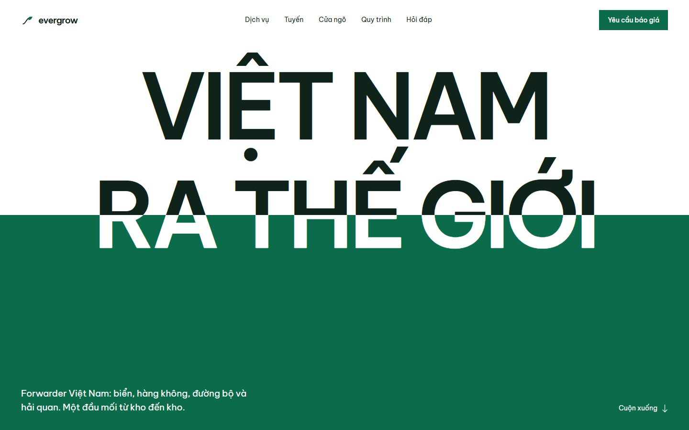

# Evergrow

Landing page tĩnh cho Evergrow, một forwarder Việt Nam: vận tải biển, hàng không, đường bộ và thủ tục hải quan.

Website dùng HTML/CSS/JS thuần, GSAP + ScrollTrigger, font Be Vietnam Pro. Bảng màu xanh lá và trắng, hướng thiết kế typographic với đường nước (waterline) ở hero.



## Chạy local

```bash
python -m http.server 4173
```

Mở `http://localhost:4173`.

Không cần build step. Mọi asset đã nằm trong repo.

## Cấu trúc

```
index.html
assets/
  css/styles.css
  js/main.js
  img/            # ảnh WebP đã tối ưu
  photos/         # ảnh gốc + credits.json
  fonts/          # Be Vietnam Pro woff2 + OFL
  vendor/         # GSAP 3.13.0 + ScrollTrigger
favicon.svg
```

## Tính năng

- Hero waterline: chữ chuyển từ mực sang trắng khi cắt qua nền xanh.
- Scroll scene ĐI → ĐẾN: stage được pin, route line vẽ dần theo scroll; ảnh Tân Vũ parallax; wordmark footer đi lên khi vào khung.
- Bộ chọn tuyến: hàng hoá, cửa ngõ, điểm đến → gợi ý phương thức, chứng từ, thời gian tham khảo và điền sẵn vào form báo giá.
- Danh sách dịch vụ, sáu cửa ngõ, quy trình bốn bước, FAQ dạng đọc.
- Form báo giá mở ứng dụng email với nội dung đã điền sẵn (không có backend).
- Responsive, menu điện thoại có bàn phím, tôn trọng `prefers-reduced-motion`.

## Nội dung mẫu cần xác nhận trước khi launch

- `hello@evergrow.vn`, văn phòng `TP.HCM · Hải Phòng · Hà Nội`, giờ làm việc.
- Khoảng thời gian vận chuyển trong bộ chọn tuyến là số liệu tham khảo, chưa gồm thông quan.
- Form chưa nối CRM/backend; hiện mở mail client.
- Logo hiện là wordmark + leaf mark được vẽ cho bản dựng này; thay bằng logo chính thức nếu có.
- Ảnh là ảnh tìm được từ Wikimedia Commons, không phải ảnh của Evergrow. Xem credit bên dưới và ở footer.

## Ảnh và giấy phép

- *Cảng Tân Vũ, Hải Phòng* — TUNMCHP, CC0.
- *Container Ship at the Hai Phong International Container Terminal* — Nathan.cima, CC BY-SA 4.0.
- *Chùa Vẽ Terminal, Port of Hải Phòng* — Phó Nháy, public domain.
- *Saigon Port* — Pieceofmetalwork, CC BY-SA 4.0.
- *ACSV Noi Bai Cargo Terminal* — WhisperToMe, CC0.
- *Container loading with forklift at warehouse in Thailand* — Goterrestrial, CC BY 4.0.
- *Hyundai truck in Vietnam* — Ilya Plekhanov, CC BY-SA 4.0.
- *Les ports du Ton-Kin, 1887* — Erhard frères, public domain.

Tất cả qua Wikimedia Commons; link nguồn nằm ở footer của trang.

Font **Be Vietnam Pro** theo SIL Open Font License 1.1 (`assets/fonts/OFL.txt`). GSAP 3.13.0 đi kèm license của GreenSock trong file vendor.
